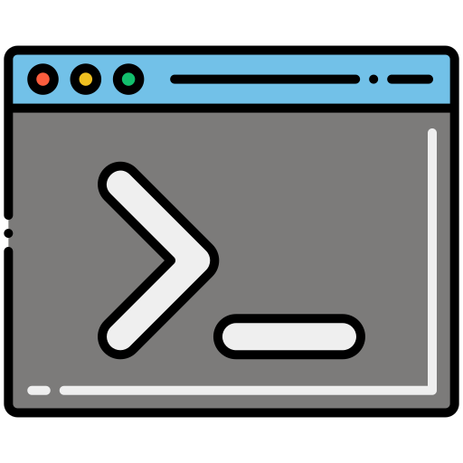
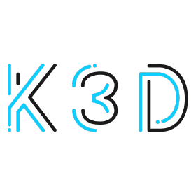

# pltfctl

<div align="center">
  <table>
    <tr>
      <td style="padding: 10px; text-align: center;">
        
      </td>
      <td style="padding: 10px; text-align: center;">
        <a href="https://k3d.io"></a>
      </td>
      <td style="padding: 10px; text-align: center;">
        <a href="https://helm.sh/"></a>
      </td>
      <td style="padding: 10px; text-align: center;">
        <a href="https://fluxcd.io"></a>
      </td>
    </tr>
  </table>
</div>

`pltfctl` is a Developer Workstation quickstart. It gives you a local,
throwaway environment on a MacBook or Ubuntu workstation, in one of three
distros: `lite` (the default: one [k3d](https://k3d.io) cluster on Cilium, 1
server + 3 agents, with a local OCI registry), `fleet` (three Cilium k3d
clusters meshed together) or `dev` (no Kubernetes: a Docker Compose stack of
Kafka, in variants: `strimzi-kraft` by default, `aiven-tiered` (tiered storage on
RustFS) or `automq` (shared-data on RustFS), chosen in `infra/compose/.variant.env`). Every k3d distro runs a GitOps operator
([Flux](https://fluxcd.io), in `flux-system`), an API gateway (KGateway) and a
Kubernetes dashboard (Kube-Argus) in `kube-system`, and a podinfo test server in
`kube-public`; Cilium is installed by `cilium-cli` before Flux. Bring it up and tear it down with a
single command, then develop against it as you would the real thing.

--------------------------------------------------

## Contents

- [How do I setup the project?](#how-do-i-setup-the-project)
- [How is this project organised?](#how-is-this-project-organised)
- [How do I publish a chart to the local registry?](#how-do-i-publish-a-chart-to-the-local-registry)
- [Where can I read more?](#where-can-i-read-more)
- [What are some references?](#what-are-some-references)

--------------------------------------------------

## How do I setup the project?

You need Docker running, plus these command-line tools on your `PATH`:

| Tool | Used for | Install (macOS) |
| --- | --- | --- |
| `docker` | runs every cluster node as a container | Docker Desktop or OrbStack |
| `docker compose` | runs the `dev` stack (Compose v2 plugin) | ships with Docker Desktop / OrbStack |
| `k3d` | creates and deletes the k3s clusters | `brew install k3d` |
| `kubectl` | talks to the clusters | `brew install kubectl` |
| `cilium` | installs Cilium on `lite` and `fleet` | `brew install cilium-cli` |
| `envsubst` | fills in the k3d config templates | `brew install gettext` |
| `curl` | downloads manifests, checks routes | preinstalled |
| `openssl` | makes podinfo's self-signed TLS cert | preinstalled |
| `jq` | reads the pod and kubelet data behind `status` | `brew install jq` |

`helm` (pushing charts to the local registry) and `flux` (debugging) are
optional. On Ubuntu, use your package manager or each tool's install docs
(`envsubst` is in `gettext-base`).

Then, from the repo root:

```sh
./scripts/pltfctl doctor          # checks the tools above and the version pins
./scripts/pltfctl up              # same as `up lite`; or `up fleet`, `up dev`
./scripts/pltfctl status          # every component's health, then total CPU, memory, disk
./scripts/pltfctl gateway status  # one component, per pod: nodes, cni, mesh, core, flux,
                                  #   gateway, dashboard, samples, event-bus
./scripts/pltfctl open            # lists the UI URLs; `open argus` opens one
./scripts/pltfctl verify          # proves HTTP, TCP, TLS and gRPC work
./scripts/pltfctl event-bus up    # optional: adds Kafka (lite only); `event-bus status`, `event-bus down`
./scripts/pltfctl event-topic grant app orders   # a topic's client identity: mTLS cert, ACLs, quotas
./scripts/pltfctl down            # deletes every pltfctl cluster and stack, then prunes Docker
```

- **One distro at a time.** The distros reuse the same host ports, so `up`
  refuses to start a second distro while another is running. Run `down` first.
- **`up` is safe to re-run.** It skips whatever already exists. It does not
  apply changed settings to an existing cluster; for that, `down` and `up`.
- **`down` removes every pltfctl cluster,** not just the one you last started:
  every k3d cluster (including a `dev` cluster left by an older pltfctl), the
  registry, the `dev` Compose stack and its volumes (every variant's), and the shared network.
- **`down` then prunes Docker host-wide.** It runs `docker system prune -f` and
  `docker volume prune -f`, which remove *every* stopped container, unused
  network, dangling image, the build cache and every unused anonymous volume on
  the machine, not only pltfctl's. Stop here if you keep stopped containers or
  anonymous volumes you care about.
- **On `dev`,** the Kafka variant is `VARIANT_KAFKA` from
  `infra/compose/.variant.env` (default `strimzi-kraft`); an exported
  `VARIANT_KAFKA=automq` overrides it for one run. Switching variant needs
  `down` first. `verify` and `open` cover the running variant; `status` and
  component status only print that they are not available in dev mode (k3d
  distros only); `event-bus` and `event-topic` need `lite`. See
  [wiki/developer/](wiki/developer/00-index.md). `pltfctl up dev`, the renamed
  `lite` and `down` with its prune have not yet been run live.
- **`status` always exits 0.** Use `verify` when you need a pass or fail.
  `<component> status` is the exception: it exits 1 when that component is
  unhealthy.
- **The first `up` is the slowest.** It downloads every image once; later runs
  copy them from your Docker cache.

[back to top](#pltfctl)

--------------------------------------------------

## How is this project organised?

```text
scripts/            every executable
  pltfctl           cluster lifecycle: up, down, status, open, verify, doctor
  projctl           housekeeping: lint, check, new-ns, new-app, clean
  lib/              the functions both scripts source
infra/              what the project creates
  .infra.env        shared by every distro: the distro list, default, each one's kind
  k3d/              k3d distros only (lite, fleet)
    fleet.env       the source of truth: clusters, ports, CIDRs, registry,
                    event-bus kinds
    <distro>/       k3d cluster templates, filled in from fleet.env
    network/        the DNS resolver every node uses
  compose/          Compose distros only (dev)
    compose.env     project name and host ports
    .variant.env    the default Kafka variant (VARIANT_KAFKA)
    <distro>-<variant>.yaml  one Compose stack per Kafka variant
deploy/             what runs on the clusters (Flux resources and manifests)
  k3d-base/         applied to every distro, by namespace
  k3d-<cluster>/    one cluster's additions, by namespace (kafka-system is
                    applied only by `pltfctl event-bus up`)
docs/contributing/  how to change this project
wiki/               how the platform works and why
assets/icons/       the banner icons above
.env.sbom           every pinned external version
```

- **Change a port, CIDR or cluster** in `infra/k3d/fleet.env`, never in a template or
  a script.
- **Add something to run on the clusters** under `deploy/`: in `k3d-base/` if every
  distro should get it, otherwise in one cluster's folder. `./scripts/projctl new-app`
  scaffolds one.
- **Read [CONTRIBUTING.md](CONTRIBUTING.md)** before changing anything, and
  [WIKI.md](WIKI.md) to learn how the pieces fit together.

[back to top](#pltfctl)

--------------------------------------------------

## How do I publish a chart to the local registry?

An OCI registry rides with the `lite` and `fleet` distros (not `dev`). Two
addresses, one target:
`localhost:5001` from the host, `oci-registry:5000` in-cluster (inside a
pod, `localhost` means the pod itself; k3d does not prefix the registry's own
container name with `k3d-` the way it does for cluster nodes).

```sh
helm package ./my-chart
helm push my-chart-0.1.0.tgz oci://localhost:5001/charts
```

Deploy it with a HelmRelease referencing the `oci-registry` HelmRepository
(already declared in `deploy/k3d-lite/flux-system/registry.yaml`; Flux sources
live in `flux-system`, so the release names that namespace):

```yaml
apiVersion: helm.toolkit.fluxcd.io/v2
kind: HelmRelease
metadata:
  name: my-chart
  namespace: kube-system
spec:
  interval: 5m
  chart:
    spec:
      chart: charts/my-chart
      version: "0.1.0"
      sourceRef:
        kind: HelmRepository
        name: oci-registry
        namespace: flux-system
```

Note: the oci-registry HelmRepository shows a blank READY column until something pulls from it — that is normal Flux behavior for OCI-type sources.

[back to top](#pltfctl)

--------------------------------------------------

## Where can I read more?

| I want to… | Go to |
| ---- | ---- |
| Understand conventions, how to add a manifest | [CONTRIBUTING.md](CONTRIBUTING.md) |
| Learn how the platforms are wired and why | [WIKI.md](WIKI.md) |
| Orient an AI agent working in this repo | [CLAUDE.md](CLAUDE.md) |
| See what the meshed platform affords a multi-cluster Strimzi Kafka, and what it deliberately does not | [wiki/multi-cluster-kafka-context.md](wiki/multi-cluster-kafka-context.md) |

[back to top](#pltfctl)

--------------------------------------------------

## What are some references?

### Build and Packaging

- [Helm](https://helm.sh): chart packaging and templating
- [Flux](https://fluxcd.io): GitOps continuous delivery that reconciles the platform

### Infrastructure and Platform

- [k3d](https://k3d.io): lightweight Kubernetes (k3s) in Docker
- [Kubernetes](https://kubernetes.io): container orchestration substrate
- [Cilium](https://cilium.io): eBPF networking, ClusterMesh, and Hubble observability

### Technology Stack

- [Kgateway](https://kgateway.dev): Gateway API control plane
- [Kube-Argus](https://github.com/manishchaudhary101/kube-argus): Kubernetes dashboard

[back to top](#pltfctl)

